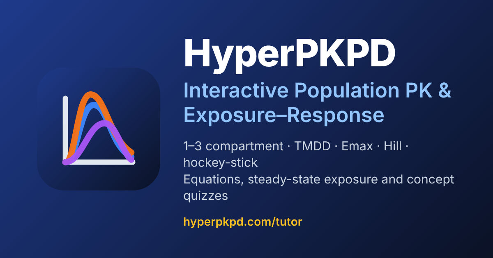

<div align="center">


# HyperPKPD Tutor

**Not a shiny app**

**See pharmacokinetics and exposure-response *move*.**
Drag a slider, watch three populations diverge, and understand why.

### Try the live demo: [hyperpkpd.com/tutor](https://hyperpkpd.com/tutor) 

Free · runs entirely in your browser · installable · works offline



</div>

---

## Why you'll want to try it

Textbook PK/PD is full of equations that are easy to read and hard to *feel*. HyperPKPD turns them into something you can play with:

- **Halve the clearance of one population and watch its curve climb above the others, live.** Three populations are always side by side, so every "what if?" has an immediate answer.
- **Switch from a 1-compartment to a 3-compartment model, or to full target-mediated drug disposition (TMDD)**, and see exactly what changes: the distribution phase, the terminal half-life, the saturable clearance.
- **Flip to Exposure–Response** and slide EC50 or the Hill coefficient to see why a steep curve makes small exposure differences matter so much, or why a threshold model can leave a low-exposure patient with no effect at all.
- **Ask the app the reverse question:** "What concentration do I need for an effect of 80?" It inverts the model analytically and draws the answer on the chart.
- **Test yourself.** Built-in quizzes (with worked explanations and a "Try it" hint that points to the right slider) cover everything from "what does increasing clearance do?" to expert-level questions on Hill-curve exposure windows.
- **It's yours to keep:** install it like a native app, use it on a plane, and come back to find every setting exactly where you left it.

If you teach, learn or practise pharmacometrics, clinical pharmacology or drug development, this is a sandbox for building intuition in minutes instead of weeks.

> **[Open the demo →](https://hyperpkpd.com/tutor)** No sign-up, no install required, nothing is uploaded.

---

## Contents

- [Features](#features)
  - [Population PK](#population-pk)
  - [Exposure–Response](#exposureresponse)
  - [Concept quizzes](#concept-quizzes)
  - [Everything else](#everything-else)
- [A 5-minute tour](#a-5-minute-tour)
- [Install it as an app](#install-it-as-an-app)
- [Models and equations](#models-and-equations)
- [Accuracy and validation](#accuracy-and-validation)
- [Run it locally](#run-it-locally)
- [Deploying](#deploying)
- [Project structure](#project-structure)
- [Configuration](#configuration)
- [Versioning](#versioning)
- [Limitations and disclaimer](#limitations-and-disclaimer)

---

## Features

### Population PK

Pick **Analysis → Population PK** in the header.

| Model | Notes |
|---|---|
| 3-, 2- and 1-compartment **oral** | First-order absorption (Ka) from a gut depot |
| 3-, 2- and 1-compartment **IV bolus** | Instantaneous input to the central compartment |
| **TMDD, 1- and 2-compartment** | Full Mager–Jusko model: free drug, free target, drug–target complex; IV bolus or first-order SC; plot free or total drug |

**Three populations, one screen.** The left panel is a tab set (Pop 1, Pop 2, Pop 3). Each tab has its own full set of inputs, so you can change one population and see the consequence against the others on the shared chart. Copy any population's settings into another with one click. Population 1 starts as a standard patient, Population 2 as renally impaired and Population 3 as high clearance.

**Inputs per population**
- Clearance, volume and half-life (linked: t½ = 0.693·V/CL), with one-click presets (Standard, Renal Impaired, High CL, High Vd)
- Absorption rate, inter-compartmental clearances and peripheral volumes (Q2/V2 and, for 3-compartment models, Q3/V3)
- TMDD: baseline target, target turnover, kon, koff, internalization, molecular weight, plus a "mAb defaults" button (typical IgG values: CL 0.25 L/day, V1 3.2 L, 100 mg q2w); TMDD models use antibody-scale slider ranges
- Dose, dosing interval (q6h to q2w) and number of doses
- Optional covariate scaling for body weight and creatinine clearance (allometric exponents are configurable)
- Therapeutic window (MEC and MTC)

**The chart**
- Concentration–time curves for every shown population, with dose markers and the therapeutic window shaded
- Linear or semi-log axis, drag-to-zoom, custom axis limits and breaks, hover read-out
- ggplot2 `theme_classic` look: thick axes, no grid

**Steady-state exposure table:** Cmax,ss, Cmin,ss, Cavg,ss, AUC over the interval, accumulation ratio, time above MEC, and (for TMDD) the lowest free-target level, one column per shown population. These are *true* steady-state values (as if dosing continued indefinitely), whatever number of doses is plotted; an extra row shows how close the last plotted dose gets (its AUC as % of steady state). Header badges flag toxicity risk or a sub-therapeutic trough at a glance.

**Equations panel:** the differential equations and integrated solutions for the selected model, parameter linkage (including terminal half-life), superposition and steady-state formulas with your numbers substituted, and the core assumptions.

### Exposure–Response

Pick **Analysis → Exposure Response**. The PK model selector is replaced by an ER model selector, the left panel changes to the parameters of the chosen model, and the chart, table, equations and quiz all follow.

| Model | Equation |
|---|---|
| Linear | E = E0 + β·C |
| Log-linear | E = E0 + β·ln(C) (or log10) |
| Emax | E = E0 + Emax·C / (EC50 + C) |
| Sigmoidal Emax (Hill) | E = E0 + Emax·C^γ / (EC50^γ + C^γ) |
| Hockey-stick (threshold) | E = E0 for C ≤ Ct;  E = E0 + β·(C − Ct) for C > Ct |

- **Reference exposure:** use each population's Cavg,ss, Cmax,ss or Cmin,ss from its Population PK simulation, or type a concentration in manually. This links the two halves of the app: change the dose on the PK side and see the effect on the ER side.
- **Target effect:** enter the effect you want and get the required concentration, solved analytically for every model (with clear messages when a target is below baseline, above the plateau, or already met).
- **Chart:** effect vs concentration for each population with linear/log x-axis, reference-exposure markers, EC50 rings, the E0 + Emax plateau, threshold markers, the target line, box zoom and axis controls.
- **Table:** predicted effect, change from baseline, % of maximal effect, C/EC50, local slope dE/dC, effect change per doubling of exposure, EC50/EC90 or threshold status, and the concentration needed for the target effect.
- **Equations panel:** model equation with derivative and inverse, parameter meanings, **live worked values** for the population you are editing, a summary table of all five models, and assumptions.

### Concept quizzes

A collapsible quiz sits above the chart. Each round draws random questions from a pool, shuffles the answer options, and explains every answer.

- **Population PK:** 38 questions (core, hard and expert levels)
- **Exposure–Response:** 51 questions, **tagged by model**, so each ER model draws 15 questions from its own set plus the general ones
- Difficulty badges, a per-level score breakdown, "New round", and best score tracked per question pool
- Many questions end with a **Try it** tip that tells you which slider to move to see the answer yourself

### Everything else

- **Remembers everything.** Every setting (model, all three populations, chart zoom, theme, panel width, quiz state) is saved in real time to IndexedDB and restored on reload. A **Reset** button restores factory defaults.
- **Resizable layout.** Drag the divider between the parameter panel and the charts (double-click to reset, arrow keys to nudge).
- **Light and dark themes.**
- **Installable and offline-capable** (PWA), with an **Install app** button in the header.
- **Search-engine friendly:** full meta tags, structured data, `robots.txt`, `sitemap.xml`, social-share image.
- **Private by design.** There is no backend: calculations run in your browser and nothing leaves your device.

---

## A 5-minute tour

1. **See a dose-response in PK.** Open the app (default: 2-compartment oral). On **Pop 2** (renal impaired) the curve sits well above the others. Hide Pop 1 and 3 with the "only" button to look at it alone.
2. **Fix an overexposed population.** Pop 2's trough is above target. Raise the dosing interval or lower the dose until the status badge turns green.
3. **Change the structure.** Switch the model to **3-Compartment IV Bolus**. Watch the distribution phases appear and read the **terminal t½** in the left panel.
4. **Go non-linear.** Choose **TMDD · 2-Compartment**, click **mAb defaults (all)** and notice that doubling the dose no longer doubles the exposure.
5. **Switch to Exposure Response.** Set **Analysis → Exposure Response**, pick **Sigmoidal Emax (Hill)**, and raise γ from 1 to 4: the same exposures now land on a much steeper part of the curve.
6. **Ask the inverse question.** Set a **Target effect** of 80 and read the required concentration; the red target line and marker appear on the chart.
7. **Quiz yourself** from the panel at the top, then press **Install app** to keep it on your desktop.

---

## Install it as an app

HyperPKPD is a Progressive Web App.

- **Chrome, Edge, Samsung Internet:** click **Install app** in the header (or use the install icon in the address bar).
- **Safari on iPhone/iPad:** Share → *Add to Home Screen*.
- **Safari on macOS:** File → *Add to Dock*.
- The button hides itself once the app is installed. After the first visit the app works offline and updates itself when a new version is released.

---

## Models and equations

**Linear PK (closed form).** Every linear model is a mamillary system solved as a sum of exponentials; doses are combined by superposition.

```
IV bolus:   C(t) = (Dose/V1) · Σ F_i · exp(−λ_i · t)
Oral:       C(t) = (Dose/V1) · Σ F_i · Ka/(Ka − λ_i) · [exp(−λ_i·t) − exp(−Ka·t)]
F_i = Π_p (k_p1 − λ_i) / Π_{j≠i} (λ_j − λ_i)        (the F_i sum to 1)
```

The exponents λ are the roots of the characteristic polynomial (a quadratic for 2 compartments, a cubic for 3). Steady-state average concentration is Dose/(CL·τ) for any linear model.

**True steady state.** Summing an infinite dose train term by term gives `Css(t) = Σ A_i·exp(−λ_i·t)/(1 − exp(−λ_i·τ))` (plus the same for the Ka term), from which Cmax,ss, Cmin,ss and time above MEC are read; AUCτ,ss is exactly Dose/CL.

**TMDD (numerical).** Integrated with a fourth-order Runge–Kutta scheme whose sub-step count is re-chosen before every output step from the current binding rate kon·(L + R). Steady state is found by continuing to dose until successive intervals stop changing (geometric-convergence test):

```
dL/dt  = input − (CL/V1)·L − (Q/V1)(L − Lp) − kon·L·R + koff·RL
dR/dt  = ksyn − kdeg·R − kon·L·R + koff·RL
dRL/dt = kon·L·R − (koff + kint)·RL
```

Drug concentrations are in nM internally and converted to mg/L with the molecular weight.

**Exposure–response.** The five models above, with analytic derivatives (for the local slope) and analytic inverses (for the target concentration), for example for Emax `C = EC50·x/(Emax − x)` where `x = E − E0`, and for Hill `C = EC50·(x/(Emax − x))^(1/γ)`. Useful identities shown in the app: EC90/EC10 = 81^(1/γ), and the Hill slope at EC50 is Emax·γ/(4·EC50).

> **A note on the log-linear model.** E = E0 + β·ln(C) is a *straight line* on a log-concentration axis and only looks curved (flattening) on a linear axis. The chart has a Linear/Log x toggle so you can see both. Because ln(1) = 0, "E0" here is the effect at C = 1 mg/L; the model has no baseline at C = 0.

---

## Accuracy and validation

- The general linear solver reproduces the earlier hand-written 1- and 2-compartment solutions to machine precision (maximum relative difference ~1e-15), and all six linear models match an independent fine-step ODE solution to ~1e-13, with and without covariate scaling.
- Linear steady-state metrics match a brute-force 300-dose simulation, Cavg,ss equals Dose/(CL·τ) exactly, and the 1-compartment IV accumulation ratio equals 1/(1 − e^(−ke·τ)).
- TMDD curves match an independent fine-step RK4 solution to ≤1e-4 relative (including strongly accumulating regimens), and TMDD steady states match long brute-force runs.
- ER slopes were checked against numerical derivatives and inverses against round-trip evaluation.
- Every numeric answer in the quizzes was recomputed independently from the model equations.
- If you edit quiz questions, re-verify any numeric answer key against `src/er/erEngine.ts` / `src/components/simulator/pkEngine.ts`.

---

## Run it locally

Requirements: a current Node.js LTS (20.19+ or 22.12+) and npm.

```bash
git clone <your-repo-url> pksims
cd pksims
npm install
npm run dev          # http://localhost:5173/tutor/
```

| Script | What it does |
|---|---|
| `npm run dev` | Development server (note the `/tutor/` base path) |
| `npm run build` | Type-check and build to `dist/` |
| `npm run preview` | Serve the production build locally (also at `/tutor/`) |
| `npm run archive` | Create `../pksims-v<version>.tar.gz` |
| `npm run icons` | Regenerate the logo, favicons and social image (needs Python + Pillow + Playwright) |

The service worker is only registered in production builds, so test installability and offline mode with `npm run build && npm run preview`.

---

## Deploying

The app is built to be served from **`https://hyperpkpd.com/tutor/`** (the Vite `base` is `/tutor/`).

1. `npm run build`
2. Upload the **contents** of `dist/` (including the hidden `.htaccess`) to the `tutor` folder of your web server.
3. Put `deploy/root-robots.txt` at the site root as `robots.txt` (search engines only read it there).
4. Submit `https://hyperpkpd.com/tutor/sitemap.xml` in Google Search Console and Bing Webmaster Tools.

Apache rules are included in `public/.htaccess`; an nginx equivalent is in `deploy/nginx-tutor.conf`. HTTPS is required for installation and offline mode. See [`DEPLOY.md`](DEPLOY.md) for the full checklist. To serve from a different URL, change `origin` and `basePath` in `src/config/siteConfig.ts` and rebuild.

---

## Project structure

```
index.html                 Meta tags, structured data and no-JS fallback ({{TOKENS}} filled at build)
vite.config.ts             Build config + plugin that emits manifest, robots.txt and sitemap.xml
version.json               Single source of the app version (shown in the header)
VERSIONS.md                Change log (newest first)
DEPLOY.md                  Hosting checklist
public/                    sw.js (service worker), icons, favicon, og-image, .htaccess
deploy/                    Root robots.txt and nginx snippet
scripts/                   archive.mjs, make-icons.py
src/
  App.tsx, main.tsx        Header (version, save status, install, theme) and entry point
  config/
    appConfig.ts           Every default, range, label and chart setting
    siteConfig.ts          Site / SEO / PWA identity
  components/simulator/
    PkSimulator.tsx        Shell: top bar, resizable layout, shared state
    PopulationPanel.tsx    PK inputs (left panel)       pkEngine.ts   PK maths
    ErPopulationPanel.tsx  ER inputs (left panel)
    PkChart.tsx / ErChart.tsx             Charts
    EquationsPanel.tsx / ErEquationsPanel.tsx   Equations, worked values, assumptions
    ErMetricsTable.tsx     ER exposure table
  er/                      erEngine.ts (pure ER maths), erTypes.ts, erDefaults.ts
  quiz/                    QuizPanel.tsx, deck.ts, quizQuestions.ts (PK), erQuestions.ts (ER)
  db/                      Dexie/IndexedDB persistence, sanitizers, usePersistedState
  pwa/                     Install-prompt hook and Install button
```

**Stack:** React 19 · TypeScript · Vite · Tailwind CSS v4 · Dexie (IndexedDB) · lucide-react. No backend and no analytics.

---

## Configuration

- **Model defaults, slider ranges, chart geometry, covariate exponents, quiz size, layout limits:** `src/config/appConfig.ts`. Components do not hard-code these.
- **Title, description, keywords, colours, base path:** `src/config/siteConfig.ts`.
- **New persisted setting:** register its key in `PERSISTENCE.keys`, use `usePersistedState(key, default, sanitizer)` and add a sanitizer so stale stored data can never break the app.
- **Add quiz questions:** append to `quizQuestions.ts` (PK) or `erQuestions.ts` (ER; set `models` to tie a question to specific ER models).

---

## Versioning

Versions follow `MAJOR.MINOR.PATCH.BUILD` and are stored in `version.json`. Every change bumps the version, adds an entry to [`VERSIONS.md`](VERSIONS.md), passes `npm run build`, and produces an archive via `npm run archive`. See `CLAUDE.md` for the full rules.

---

## Limitations and disclaimer

- HyperPKPD is an **educational tool**. It is not validated for clinical decision-making, dose selection or regulatory work.
- Parameters are typical population values: there is no between-subject variability, residual error or covariate model on the ER parameters.
- ER models assume a direct, instantaneous, reversible effect of a single exposure metric (no hysteresis, tolerance or disease progression).
- Bioavailability is taken as 1 (parameters are apparent CL/F and V/F). TMDD assumes 1:1 binding in the central compartment.
- Steady-state metrics are true steady-state values; the plotted curve shows only the regimen you set (number of doses), so with a long terminal phase the plotted last dose can be well below steady state (see the "Last simulated dose" row). For extremely slow TMDD drugs the steady-state search may stop at its computation budget; the table then says the values are approximate.

---

<div align="center">

**[Try HyperPKPD now → hyperpkpd.com/tutor](https://hyperpkpd.com/tutor)**

</div>
